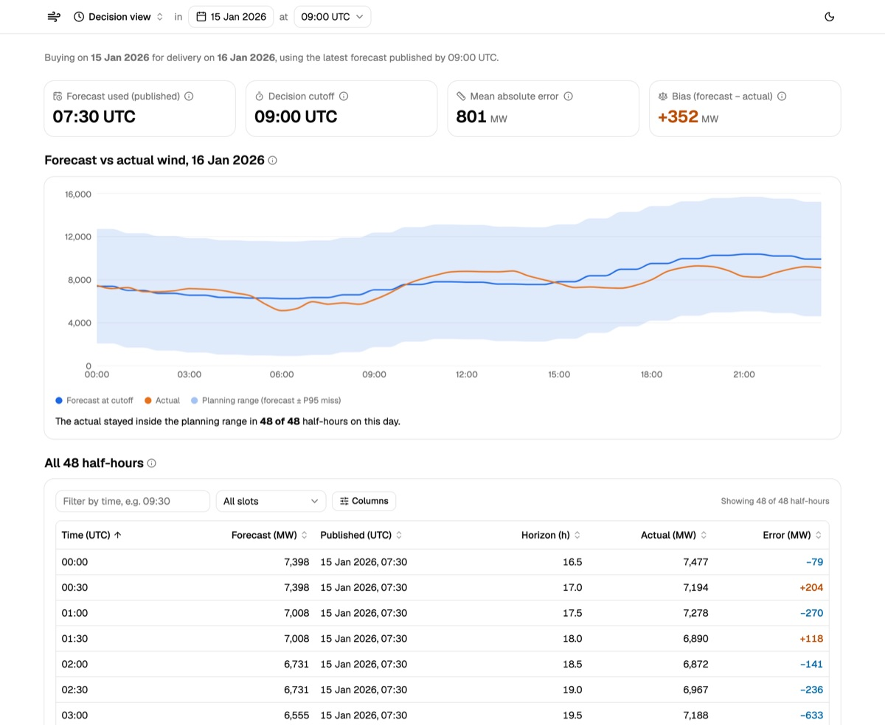
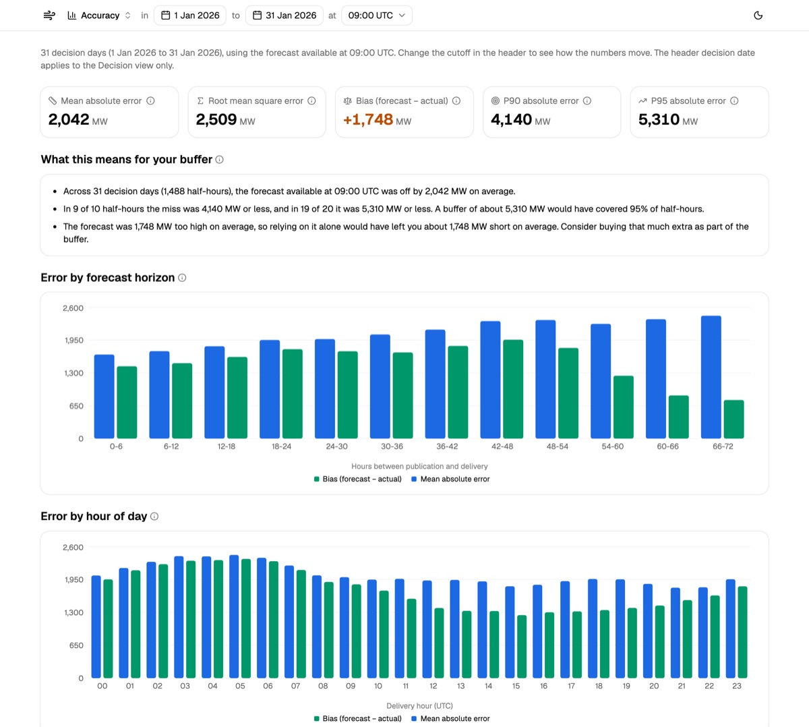
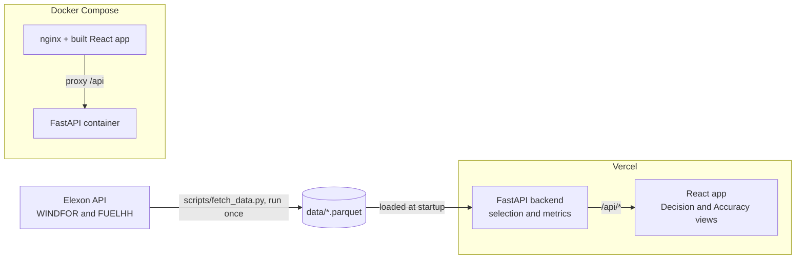

# Wind forecast desk

A web app for a UK utility's day-ahead power buying team. It uses national-level Elexon wind data only (forecasts from WINDFOR, actuals from FUELHH) and covers purchase decisions made in January 2026.

**Live app: https://d1mocv.vercel.app**

| Decision view | Accuracy view |
|---|---|
|  |  |

## The two questions it answers

1. **What was the latest wind forecast available when the buying decision had to be made?**
   The Decision view shows, for one delivery day, the 48 half-hours with the forecast that existed at the cutoff on the day before (D-1), when it was published, and what actually happened.
2. **How wrong are the forecasts, in MW, so the team can plan a buffer?**
   The Accuracy view gives MAE, RMSE, bias, P90 and P95 of the miss, error by forecast horizon and by hour of day, and a plain-English reading of the numbers.

For January 2026 at the default 09:00 UTC cutoff, over all 31 decision days: MAE 2,042 MW, RMSE 2,509 MW, bias +1,748 MW (forecast too high), P90 4,140 MW and P95 5,310 MW.

## How it works

For each half-hour of the delivery day, the app takes the forecast with the **latest publish time at or before the cutoff on D-1**. A forecast published exactly at the cutoff is included. Anything published later is ignored, because the buyer could not have seen it. That forecast is compared with the FUELHH actual.

```
error = forecast - actual
```

Positive error means the forecast was too high, so a buyer relying on it would be short. Negative means they overbought.



The deployed app never calls Elexon. The data is fetched once, checked, and shipped as two small parquet files (about 100 KB in total).

## Assumptions

The important ones are below. Every assumption, with its status, how it was checked and what changes if it is wrong, is in [ASSUMPTIONS.md](ASSUMPTIONS.md).

- **Cutoff: 09:00 UTC on D-1**, selectable in the UI. GB day-ahead auctions close at 09:20 UK time (EPEX) and 09:50 UK time (N2EX), so 09:00 sits before both. This comes from published exchange information, not the current rulebooks.
- **Decision dates are 1 to 31 January 2026**, so delivery days are 2 January to 1 February 2026.
- **All times are UTC.** January is GMT, so this is also UK local time.
- **WINDFOR is hourly and FUELHH is half-hourly**, so each hourly forecast is used for both half-hours of that hour.
- WINDFOR published eight times a day in January. With a 09:00 cutoff the latest usable publish is 07:30, so no slot is dropped. Earlier cutoffs can leave slots with no forecast; the app drops and counts them.

## Metric definitions

All values are in MW over half-hour slots.

| Metric | Meaning |
|---|---|
| MAE | Mean of the absolute error. The typical size of a miss. |
| RMSE | Square root of the mean squared error. Weights big misses more. |
| Bias | Mean of the signed error. Positive: forecast too high on average. |
| P90, P95 | 90th and 95th percentile of the absolute error (linear interpolation). 9 in 10 and 19 in 20 misses are this size or smaller. |
| Error by horizon | Every published forecast version, grouped in 6-hour buckets by how long before the half-hour it was made. Does not depend on the cutoff. |
| Error by hour of day | The decision-time forecast, grouped by the UTC hour being delivered. |

MAPE is not used: it blows up when wind is near zero.

## Run it

### With Docker

Needs Docker and Docker Compose.

```bash
docker compose up --build
```

Open http://localhost:8080. The API is on http://localhost:8000 (its docs are at `/docs`). If a port is taken, set `WEB_PORT` or `API_PORT`:

```bash
WEB_PORT=8081 docker compose up --build
```

Stop with `docker compose down`.

### Without Docker

Needs [uv](https://docs.astral.sh/uv/) and Node 22.

```bash
make install     # uv sync and npm ci
make dev-api     # terminal 1: API on http://localhost:8000
make dev-web     # terminal 2: app on http://localhost:5173
```

Without `make`: run `uv sync --frozen` in `backend/`, then `uv run uvicorn app.main:app --reload`; and `npm ci` then `npm run dev` in `frontend/`. The dev server proxies `/api` to port 8000.

### Tests, lint and data

```bash
make test           # backend (pytest) and frontend (vitest)
make lint           # ruff and eslint, plus format checks
make fetch-data     # re-download the Elexon data into data/ (the repo already contains it)
make gen-api        # regenerate the frontend API types after changing the backend
make export-requirements   # regenerate requirements.txt for Vercel after changing backend dependencies
```

CI (`.github/workflows/ci.yml`) runs the backend and frontend checks, fails if the generated API types or `requirements.txt` are out of date, and builds the Docker images.

The most important tests are the cutoff-logic tests in `backend/tests/test_selection.py` (published exactly at the cutoff, just after, several versions, none available) and a cross-check that recomputes the selection and the metrics with plain Python loops and compares them with the pandas results for every delivery day.

## API

| Endpoint | Purpose |
|---|---|
| `GET /api/health` | Liveness check. |
| `GET /api/meta` | Available decision dates, default cutoff, units, error definition. |
| `GET /api/forecast-at-decision?decision_date=&cutoff_hour=` | Requirement 1: the 48 half-hours with the selected forecast, its publish time and the actual. |
| `GET /api/accuracy?start=&end=&cutoff_hour=` | Requirement 2: MAE, RMSE, bias, P90, P95, error by horizon and by hour. |

Bad parameters return 422 and decision dates outside January 2026 return 404, both with the same JSON error shape. The deployed function also serves the schema at `/openapi.json` and Swagger UI at `/docs`.

## Files and directories

```
.
├── backend/                  FastAPI app (Python 3.12, managed with uv)
│   ├── app/
│   │   ├── main.py           app factory, CORS, request logging
│   │   ├── routers/api.py    the four endpoints (HTTP only)
│   │   ├── services/
│   │   │   ├── selection.py  forecast-at-cutoff logic
│   │   │   └── metrics.py    MAE, RMSE, bias, percentiles, by horizon and hour
│   │   ├── data/             parquet loader and data validation checks
│   │   ├── schemas/          Pydantic response models
│   │   └── core/             settings and error handling
│   ├── tests/                pytest: cutoff logic, metrics, API, data, cross-checks
│   ├── Dockerfile
│   └── pyproject.toml, uv.lock
├── frontend/                 React 18, TypeScript, Vite, Tailwind, shadcn/ui
│   ├── src/
│   │   ├── views/            Decision and Accuracy views
│   │   ├── components/       layout (sidebar, pickers), shared pieces, shadcn/ui
│   │   ├── api/              typed client, query hooks, generated schema.d.ts
│   │   ├── state/            date and cutoff, kept in the URL
│   │   └── lib/              formatting, dates, takeaway text, planning band
│   ├── Dockerfile, nginx.conf
│   └── openapi.json          schema the API types are generated from
├── data/                     actuals.parquet and forecasts.parquet (Elexon snapshot)
├── scripts/
│   ├── fetch_data.py         downloads and validates the Elexon data
│   └── export_openapi.py     prints the OpenAPI schema for type generation
├── api/index.py              Vercel entry point for the FastAPI app
├── vercel.json               Vercel routing and build settings
├── requirements.txt          exported from backend/uv.lock, used by Vercel
├── docker-compose.yml
├── Makefile
├── .github/workflows/ci.yml
├── docs/screenshots/         images used in this README
├── ASSESSMENT.md             the brief
├── ASSUMPTIONS.md            every assumption and observation
├── DECISIONS.md              product and scope decisions
├── TECH.md                   stack and structure
└── PLAN.md                   phased checklist and progress
```

## Deployment

One Vercel project: the React build is served as static files and `api/index.py` runs the FastAPI app as a single Python function with `backend/app` and `data/` bundled in (about 39 MB with pandas and pyarrow). `framework` is set to `null` in `vercel.json`; otherwise Vercel treats the project as a FastAPI backend and skips the frontend. See A16 in [ASSUMPTIONS.md](ASSUMPTIONS.md).

## AI tools used

This project was built with AI assistance. **Claude Code** (Anthropic, running the Claude Sonnet 5.5 model) was used throughout to write and refactor the backend, frontend, tests, Docker and CI setup, and the documentation, and to run checks and deployments. The product decisions (scope, cutoff, metrics, stack, what to cut) are recorded in [DECISIONS.md](DECISIONS.md), and each phase was reviewed and committed by the author. The UI components under `frontend/src/components/ui` were generated with the shadcn/ui CLI.

## Limitations and next steps

- **Static snapshot.** The data is fetched once and shipped with the app. Next steps are a scheduled ingest job and a database, so new days appear without a redeploy.
- **Forecasts run high.** Over January the bias is about +1,750 MW at every horizon, including forecasts made 0 to 6 hours ahead. The cause is not established; WINDFOR and FUELHH may not measure exactly the same wind (A15). The app reports it as it is and does not correct for it.
- **The planning range is in-sample.** The band on the Decision chart is the forecast plus or minus the January P95 miss, measured on the same data it is drawn over, and it ignores the bias (A18). A future month would need out-of-sample validation.
- **Hourly forecasts, half-hourly actuals.** Repeating the hourly value is the simplest rule, not the only one (A5).
- **Cutoff is a whole hour.** The logic accepts any minute; the UI and API offer whole hours.
- **Gate closure time** comes from published exchange information, not the current rulebooks.
- **Interactive API docs** (`/docs`) load their script from a CDN, so they need internet access.
- **Not done:** authentication (the data is public), other fuel types or sources, forecast revision history per slot, and our own forecasting model.
