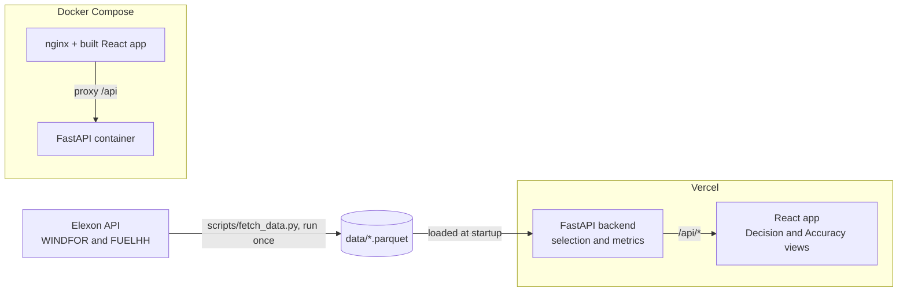

# Part 2 tech walkthrough (≤5 min) — tech lead review

Use the mermaid from the README (it matches the deployment). Open the files below in order; the goal is architecture + the logic that makes the answer correct, not a line-by-line dump.

## Timing
| Section | Time | What to cover |
| --- | --- | --- |
| 1) Architecture diagram | 0:00–0:45 | Reuse README flowchart; call out static snapshot (no live Elexon calls in prod), Vercel vs Docker Compose paths. |
| 2) Data pipeline | 0:45–1:45 | `scripts/fetch_data.py` (one-shot, validate, write parquet), `data/` snapshots, `backend/app/data/` loading/validation. |
| 3) Cutoff logic (the crux) | 1:45–2:55 | `backend/app/services/selection.py` (latest `publishTime` ≤ cutoff per `startTime`; slots with none dropped and counted). |
| 4) Tests | 2:55–3:30 | `backend/tests/test_selection.py` (boundary fixtures, exact-at-cutoff included; plain-Python cross-check over every delivery day). |
| 5) Metrics + API | 3:30–3:55 | `backend/app/services/metrics.py` (MAE/RMSE/bias/P90/P95, horizon buckets) and `backend/app/routers/api.py` (four endpoints, uniform error envelope). |
| 6) Frontend + deploy + close | 3:55–5:00 | `frontend/src/components/shared/slots-table.tsx` (Req 1/2 in UI, generated API types, URL-synced state); `vercel.json` + `ci.yml`; practices and trade-offs. |

## Architecture (README mermaid)

Notes: the deployed app never calls Elexon; two tiny parquet files are shipped. Vercel runs FastAPI as a Python function with the same app. Docker Compose shows the self-contained local path.

## File tour (one-liners)
| File | Say |
| --- | --- |
| `scripts/fetch_data.py` | One-shot pull, normalize schemas, basic validation, write parquet. Reproducible and committed as a snapshot. |
| `backend/app/services/selection.py` | Per slot pick the latest forecast where `publishTime <= cutoff`. Exact equality included. Slots with no forecast → null and are dropped and counted. This is the rule used everywhere. |
| `backend/tests/test_selection.py` | Four boundary cases + a plain-Python cross-check against the implementation for all delivery days in the snapshot. If the cross-check ever disagrees, the test fails. |
| `backend/app/services/metrics.py` | Error = forecast − actual (positive = forecast too high). MAE, RMSE, bias, P90/P95 (quantiles), and metrics split by horizon bucket. MAPE skipped. |
| `backend/app/routers/api.py` | Four endpoints (`/api/health`, `/api/meta`, `/api/forecast-at-decision`, `/api/accuracy`), schema validation, uniform JSON error envelope. OpenAPI at `/docs`. |
| `frontend/src/components/shared/slots-table.tsx` | Maps Req 1 (the forecast-at-decision set) and Req 2 (the error table) to the UI. Uses generated API types and URL-synced filters/state; empty states shown for dropped slots. |
| `vercel.json` + `.github/workflows/ci.yml` | `vercel.json` routes `/api/*` to the serverless FastAPI app; CI runs backend tests (`pytest`) and frontend typecheck/lint/build on every push. |

## Practices (close in 20s)
- **Reproducible env**: `uv` lockfiles for backend; Vite + Node for frontend; Dockerfiles for both paths.
- **Tested logic**: selection cross-check + unit tests; 43 backend tests and 31 frontend tests pass in CI.
- **Correctness over polish**: uniform error envelope, error boundary in React, explicit "dropped and counted" behavior.
- **Deterministic data**: static snapshot in `data/` keeps the deployed app fast and avoids external runtime dependencies.
- **Clean history**: neutral git identity, no secrets, public repo with README/TECH/DECISIONS/ASSUMPTIONS in place.

## Trade-offs & next steps (close)
- **Static snapshot**: answers are reproducible for Jan 2026; next is a scheduled job to ingest live Elexon data.
- **In-sample analysis**: metrics are on the snapshot (Jan 2026). Next is out-of-sample validation across seasons.
- **Bias uncorrected**: the forecast runs high (+1.75 GW on average); we report it but do not auto-correct it (would need a separate study).
- **AI chat dropped**: considered, but serverless streaming/timeouts/cost made it harder to ship reliably; the core requirements were prioritized.

## Recording notes
- Show the README mermaid first (matches docs). Don't click through 20 files — only the seven above.
- Spend most time on `selection.py` and `test_selection.py` (the correctness story).
- Keep the terminal clean (neutral prompt), record in a clean profile, rehearse to ~4:30.
- Total Part 2 ≤5:00.
